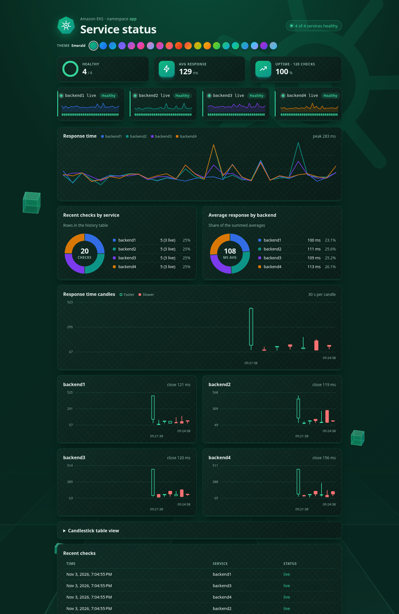
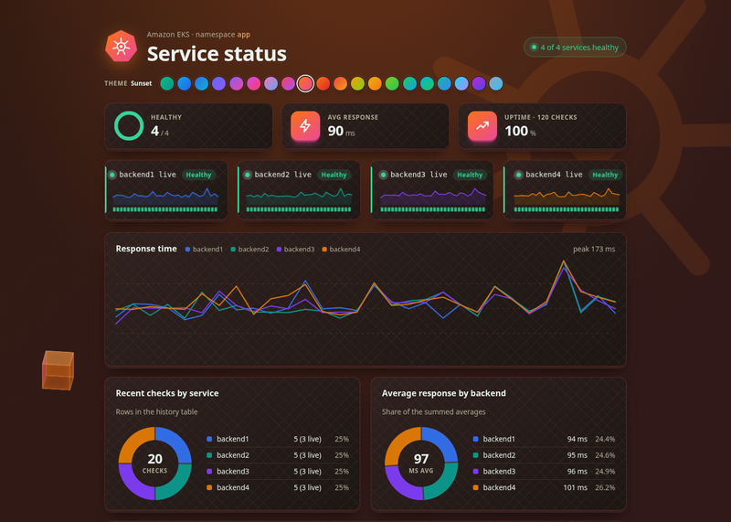
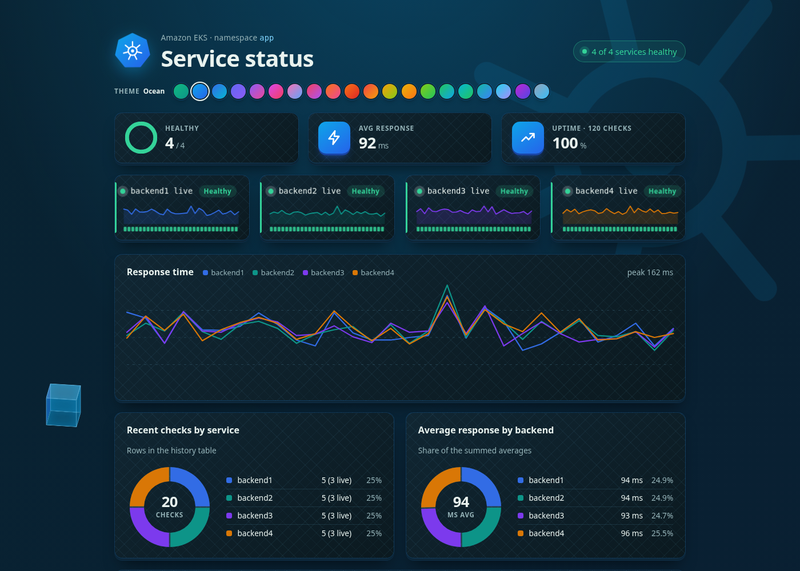

# Service status dashboard on Amazon EKS

An Angular dashboard that shows the health of four FastAPI backends, with response-time charts, pie and candlestick
views, and 20 dark gradient themes. Postgres stores the status history. The same code runs two ways:

* **Docker Compose** on your laptop (5 minutes, no cloud account).
* **Amazon EKS** with Terraform/Terragrunt, GitHub Actions and Argo CD, behind one shared Application Load Balancer.



<table>
  <tr>
    <td></td>
    <td></td>
  </tr>
</table>

## What is in the box

| Part | Technology | Folder |
|---|---|---|
| Frontend | Angular (standalone components, signals), served by nginx, which also proxies `/api/backendN/*` | `frontend/` |
| Backends (4) | FastAPI + psycopg, endpoints `/status`, `/history`, `/health` | `backend1/` ... `backend4/` |
| Database | PostgreSQL 16 (container locally, RDS on AWS) | |
| Local stack | Docker Compose | `docker-compose.yml` |
| Infrastructure | Terraform modules run with Terragrunt: VPC, ECR, EKS, RDS, ALB controller, GitHub OIDC | `terraform/` |
| Manifests | Plain Kubernetes + Kustomize (rolling updates, PodDisruptionBudgets, anti-affinity) | `kubernetes/` |
| GitOps | Argo CD (Helm), one `Application` for `kubernetes/` | `argocd/` |
| CI/CD | GitHub Actions: test, build, release, verify, automatic rollback | `.github/workflows/deploy.yml` |
| Monitoring | Prometheus and Grafana (optional) | `monitoring/` |
| One-command up/down | `scripts/up.sh`, `scripts/down.sh` | `scripts/` |

How the frontend reaches the backends: the browser only talks to its own origin. nginx forwards
`/api/backend1/...` to the service `backend1:8000` (Compose service name locally, Kubernetes Service `backend1` in the
`app` namespace on EKS), so there is no CORS and no backend is exposed to the internet.

```
browser ──> nginx (frontend) ──/api/backend1..4──> FastAPI backend1..4 ──> PostgreSQL
```

---

## Option A: run it with Docker Compose

### Prerequisites

* Docker with the Compose plugin (`docker compose version` should print a version).
* Free ports: `4200` (web), `8001`-`8004` (backends), `5432` (Postgres).

### Steps

```bash
git clone git@github.com:<your-github-user>/full-app-eks.git
cd full-app-eks

docker compose up -d --build      # first build takes a few minutes (npm install, pip install)
docker compose ps                 # wait until every service shows "healthy"
```

Open **http://localhost:4200**. You should see four services, each with a green "Healthy" badge.

Check the backends directly:

```bash
curl localhost:8001/status        # {"service":"backend1","status":"live","message":"backend1 live","db":true}
curl localhost:8001/health        # {"status":"ok"}
curl "localhost:8001/history?service=all&limit=5"
curl localhost:4200/api/backend2/status     # the same call through the nginx proxy the browser uses
```

Everyday commands:

```bash
docker compose logs -f backend1   # follow one service
docker compose stop backend3      # the dashboard shows it as "off" within a few seconds
docker compose start backend3
docker compose down               # stop everything, keep the database volume
docker compose down -v            # stop everything and delete the database
```

The candlestick charts fill in over time (one candle is 30 seconds of checks); leave the page open for a few minutes.

### Without Docker for the frontend (optional, for development)

```bash
docker compose up -d postgres backend1 backend2 backend3 backend4
cd frontend
npm ci
npm start                         # http://localhost:4200, proxy.conf.json forwards /api/backendN to ports 8001-8004
npm test                          # unit tests
```

Backend tests (any one service, same for the others):

```bash
cd backend1
python -m venv .venv && . .venv/bin/activate
pip install --require-hashes -r requirements.txt   # hashed pins; the dev tools below are not hashed, so a second command
pip install -r requirements-dev.txt
python -m pytest -q
```

---

## Option B: deploy it to Amazon EKS

This builds a real cluster and costs money while it runs (about **$0.40 per hour**, roughly $290 a month if left on:
2 x `c7i-flex.large` nodes, one NAT gateway, RDS `db.t4g.micro` and one shared ALB). Run `scripts/down.sh` when you are
done. The cost table is in [docs/DEPLOYMENT.md](docs/DEPLOYMENT.md#monthly-cost).

```
 GoDaddy CNAMEs ──> ONE shared ALB (HTTPS, wildcard ACM certificate)
                      ├─ k8application.<your-domain> ──> frontend ──> backend1..4 ──> RDS PostgreSQL
                      ├─ argocd.<your-domain>        ──> Argo CD
                      └─ monitoring.<your-domain>    ──> Grafana
 EKS cluster "app-study": 2 nodes in private subnets, images in ECR, Argo CD keeps namespace "app" equal to kubernetes/
```

### 1. Prerequisites

* An AWS account and an IAM user that can administer it; `aws configure` done (`aws sts get-caller-identity` works).
* Tools: `aws`, `terraform` (1.10 or newer), `terragrunt`, `kubectl`, `helm`, `docker` (running), `git`, `curl`, `ssh-keygen`.
* A domain you control and an **ACM certificate** for `*.your-domain` in `us-east-1`.
* A GitHub repository holding this code (Argo CD reads it).

### 2. Make it yours (once)

The repository ships with the values of the original author's account, domain and repository. Replace them with yours
before the first run. Find each one with the command in the right-hand column:

| Value | Where it is | Find it with |
|---|---|---|
| AWS account id (12 digits) | `scripts/common.sh` (`EXPECTED_ACCOUNT`), `kubernetes/kustomization.yaml`, `.github/workflows/deploy.yml`, `terraform/live/study/eks/terragrunt.hcl` | `grep -rnE "[0-9]{12}" scripts kubernetes .github terraform/live` |
| Host names (`k8application.`, `argocd.`, `monitoring.`) and the ACM certificate ARN | `kubernetes/ingress.yaml`, `argocd/values.yaml`, `monitoring/values.yaml` | `grep -rnE "k8application\.|argocd\.[a-z]+\.|certificate-arn|arn:aws:acm" kubernetes argocd monitoring` |
| GitHub repository (`<owner>/full-app-eks`) and its numeric owner and repository ids | `argocd/application.yaml`, `terraform/live/bootstrap/github-oidc/terragrunt.hcl` | `grep -rn "github.com\|github_owner_id\|github_repo" argocd terraform/live/bootstrap` |

Use `<your-account-id>`, `<your-domain>` and `<your-github-user>` in the steps below as your own values.

### 3. Create everything with one command

```bash
scripts/up.sh                    # about 20-25 minutes; add --no-monitoring to skip Prometheus and Grafana, -y to skip the question
```

What it does: Terraform (VPC, ECR, EKS, RDS, ALB controller), builds and pushes the images, creates the `database`
secret, installs Argo CD, applies the application, ingresses and monitoring, then prints the load balancer address.
Every step skips work that is already done, so it is safe to run again.

**First run stops once.** It creates a read-only SSH key for Argo CD, prints the public half and exits without creating
anything in AWS. Add that key in GitHub (repository **Settings, Deploy keys, Add deploy key**, leave "Allow write access"
off) and run `scripts/up.sh` again.

### 4. Point DNS at the load balancer

`up.sh` prints the ALB hostname at the end (also `kubectl get ingress -A`). At your DNS provider create CNAME records
for `k8application`, `argocd` and `monitoring`, all pointing to that hostname. A rebuild creates a new ALB with a new
hostname, so repeat this after every `up.sh` on a fresh cluster.

### 5. Verify

```bash
aws eks update-kubeconfig --region us-east-1 --name app-study
kubectl get nodes                                  # 2 Ready
kubectl get pods -n app                            # 5 deployments x 2 pods, all Running
kubectl get ingress -A                             # same ALB address on every ingress
kubectl -n argocd get application app              # Synced / Healthy
```

Open `https://k8application.<your-domain>`. Log in to Argo CD at `https://argocd.<your-domain>` with user `admin`:

```bash
kubectl -n argocd get secret argocd-initial-admin-secret -o jsonpath='{.data.password}' | base64 -d; echo
```

### 6. Ship changes (CI/CD)

One-time, by hand, so GitHub Actions can log in to AWS without stored keys:

```bash
cd terraform/live/bootstrap/github-oidc
terragrunt backend bootstrap && terragrunt apply     # OIDC provider and the roles app-github-{plan,images,verify,infra}
```

After that, a push to `master` does everything:

1. `test` runs pytest for each backend.
2. `build` builds and pushes all five images, tagged with the commit.
3. `release` writes the new tag into `kubernetes/kustomization.yaml`; Argo CD rolls it out.
4. `verify` waits for the rollout and smoke-tests the site through the ALB.
5. `rollback` reverts the release commit automatically if `verify` finds the release bad.

Infrastructure changes are applied only from **Actions, deploy, Run workflow**, never by a plain push.

### 7. Delete everything (stops the cost)

```bash
scripts/down.sh                  # removes the apps, Argo CD, the ALB, then runs terragrunt destroy
```

The Terraform state bucket `app-tfstate-<account>-us-east-1` stays; empty and delete it by hand if you want it gone.

### Deployment strategy

Rolling update with `maxUnavailable: 0` and `maxSurge: 1`, 2 replicas per service, readiness probes, a `preStop` sleep,
PodDisruptionBudgets, soft pod anti-affinity, a 30 second ALB deregistration delay and the ALB pod readiness gate.
New pods must pass their checks before an old pod is stopped, so a release causes no downtime, and a broken image never
receives traffic. Rollback is `git revert` of the `chore: deploy images <sha>` commit (the pipeline does it for you
when the post-deploy check fails).

---

## Documentation

* [docs/DEPLOYMENT.md](docs/DEPLOYMENT.md): the full guide (architecture, first deployment, daily operations, security measures, known gaps, troubleshooting).
* [terraform/README.md](terraform/README.md): the infrastructure modules and manual Terraform steps.
* [kubernetes/README.md](kubernetes/README.md): the manifests and manual `kubectl` steps.
* [monitoring/README.md](monitoring/README.md): Prometheus and Grafana.
